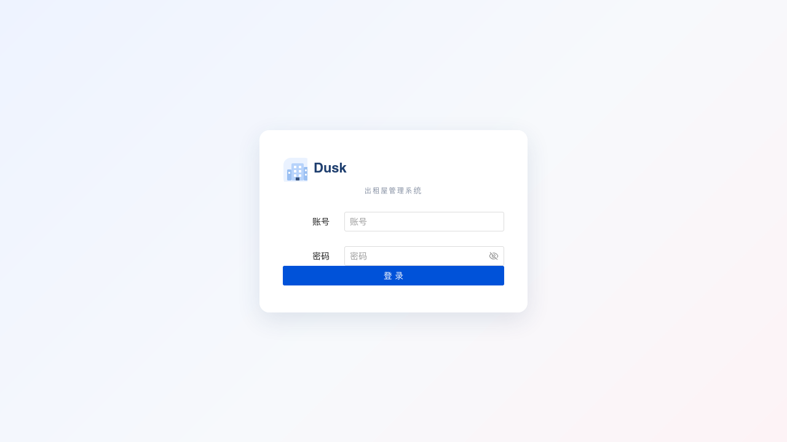
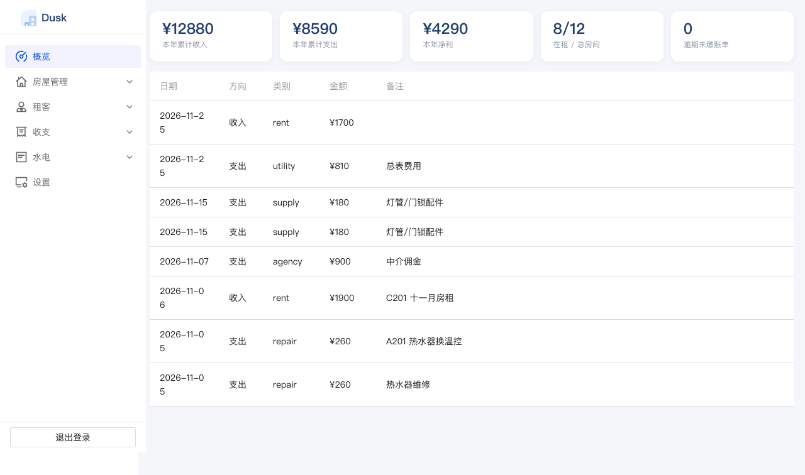

# Dusk · 出租屋管理系统

跑在 Cloudflare 免费档上的出租屋（二房东）管理后台：房产、房间、租客、合同、账单、水电分摊、收支柱报表，一套全收。零服务器、零月费，Workers + D1 免费额度即可长期运行。

[](https://github.com/duskly-jpg/dusk/actions/workflows/ci.yml)
[](LICENSE)

| 登录 | 仪表盘 |
|---|---|
|  |  |

## 功能

- **仪表盘**：楼 / 房 / 客 KPI、本月收支、应收账款一眼清
- **房产 / 房间**：楼栋管理、房间档案（面积/楼层/设施/水电单价），状态由租约生命周期推导
- **租约**：入住即建约，到期剩余天数红黄绿预警，退房一键解绑复位
- **账单**：发票式计费（房租 / 水电 / 罚金 / 退押），应缴日 + 逾期天数实时计算，宽限期 + 日罚金引擎一键计罚
- **水电分摊**：计费周期显式创建 → 房间抄表 → 总 / 分摊用量差额一目了然，结算自动生成各房费用账单与支出流水
- **收支流水**：单笔入账可溯源（账单 / 支出 / 水电），循环支出自动生成下期
- **鉴权**：PBKDF2-SHA256 口令哈希 + HMAC 会话令牌，HttpOnly Cookie，首次访问引导初始化管理员

## 技术栈

| 层 | 选型 |
|---|---|
| 运行时 | Cloudflare Workers（免费档） |
| 后端 | Hono（TypeScript） |
| 数据库 | Cloudflare D1（SQLite） |
| 前端 | Vue 3 + TDesign（本地自托管，无外链 CDN） |
| 鉴权 | WebCrypto PBKDF2 + HMAC，`hono/cookie` |

## 部署（约 10 分钟）

```bash
# 1. 安装依赖
npm install

# 2. 建 D1 库并记下 database_id
npx wrangler d1 create dusk

# 3. 写真实配置（参考 wrangler.example.jsonc）
cp wrangler.example.jsonc wrangler.jsonc
#    填入 database_id 与你的域名 route

# 4. 灌表结构 + 种子数据
npx wrangler d1 execute dusk --remote --file=schema.sql
npx wrangler d1 execute dusk --remote --file=seed.sql

# 5. 设置会话签名密钥
openssl rand -hex 32 | npx wrangler secret put AUTH_SECRET

# 6. 部署
npx wrangler deploy
```

首次访问会引导创建管理员账号；请勿在生产环境使用代码内 fallback 密钥（`AUTH_SECRET` 必须设置）。

## 领域模型

二房东场景的核心是一条**租约生命周期**驱动的状态机：

```
楼栋 1─* 房间 1─* 租约（活跃/到期/退租）
                │
                ├─* 账单（房租/水电/罚金/退押） ─* 收入流水
                └─* 抄表记录 ─* 水电结算 ─* 支出流水
```

- **房间状态不手工维护**：由租约推导——有活跃租约即「在租」，退房解绑自动复位「空置」，杜绝账实不符
- **账单即发票**：一行账单聚合当期所有应收项（房租 + 水电 + 逾期罚金 - 押金抵扣），应缴日、宽限期、逾期天数全部落库可查
- **水电分摊显式建周期**：总表/分表用量差额分摊，结算一键生成各房账单与支出流水，避免口头扯皮
- **每一笔流水可溯源**：收入流水必挂账单或水电结算，支出流水必挂类别与周期，报表数字从底层聚合而来

## 安全设计

- **口令存储**：PBKDF2-SHA256（100k 迭代）+ 每用户独立盐，WebCrypto 原生实现，零第三方依赖
- **会话**：HMAC-SHA256 签名令牌，HttpOnly + SameSite=Lax Cookie，服务端无会话表（令牌自校验）
- **时序安全**：口令比对恒定时间比较，用户不存在与密码错误返回同一提示
- **注入面**：全部查询走参数绑定，无字符串拼接 SQL

## 仓库纪律

- **域名即配置**：代码零硬编码域名，`wrangler.jsonc`（真实配置）不入仓
- **密钥零落盘**：`AUTH_SECRET` 走 `wrangler secret`，代码只出现变量名
- **部署断言闸门**：发布前 HTML 标签配对 / 关键串断言，FAIL 拒发

## License

MIT（见 [LICENSE](LICENSE)）。
